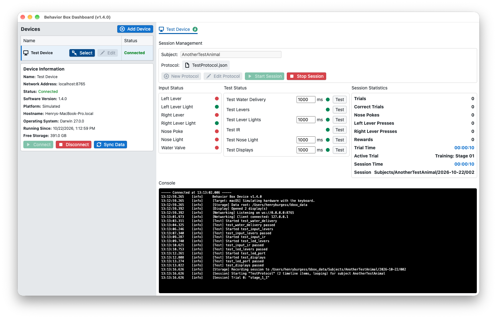

# Behavior Box Controller

This repository contains the code to control a behavior box utilizing IO and displays.

## Table of Contents

- [Repository Structure](#repository-structure)
- [Installation](#installation)
  - [Dashboard Installation](#dashboard-installation)
  - [Device (Raspberry Pi) Installation](#device-raspberry-pi-installation)
- [Requirements](#requirements)
  - [Software Dependencies](#software-dependencies)
  - [Hardware Requirements](#hardware-requirements)
- [Raspberry Pi Setup](#raspberry-pi-setup)
  - [Automated Installation (Recommended)](#automated-installation-recommended)
  - [Manual Setup (Advanced)](#manual-setup-advanced)
  - [Starting the Device](#starting-the-device)
  - [Troubleshooting](#troubleshooting)
- [Dashboard](#dashboard)
  - [Running the Dashboard](#running-the-dashboard)
  - [Session Management](#session-management)
- [Device](#device)
  - [Simulation](#simulation)
  - [Controls in Simulation Mode](#controls-in-simulation-mode)
  - [Hardware Usage](#hardware-usage)
- [Device Operation](#device-operation)
  - [Log Files](#log-files)
  - [Data](#data)
  - [Version Tracking](#version-tracking)
- [Issues and Feedback](#issues-and-feedback)
- [License](#license)

## Repository Structure

```text
bbox_controller/
├── packages/              # Source code
│   ├── dashboard/        # Dashboard application (PyQt6 GUI)
│   ├── device/           # Device controller (runs on Raspberry Pi)
│   └── shared/           # Shared code between dashboard and device
├── apps/                 # Application-specific files
│   ├── dashboard/        # Dashboard config, requirements, start script
│   └── device/           # Device config, requirements, start script
└── version.py            # Version tracking
```

## Installation

### Dashboard Installation

**macOS/Linux:**

```bash
git clone <repository-url>
cd bbox_controller
./install/install_dashboard.sh
./apps/dashboard/start.sh
```

**Windows:**

```cmd
git clone <repository-url>
cd bbox_controller
install\install_dashboard.bat
launch_dashboard.bat
```

### Device (Raspberry Pi) Installation

```bash
git clone <repository-url>
cd bbox_controller
sudo ./install/install_device.sh
sudo ./launch_device.sh
```

See [install/README.md](install/README.md) for detailed instructions and troubleshooting.

## Requirements

### Software Dependencies

**Python Version:**

- Python 3.11 or later (required)

**Dashboard Packages:**

- `PyQt6` (GUI framework)
- `websocket-client` (network communication)
- `Pillow` (image processing)

**Device Packages:**

- `pygame` (game engine for simulation controls)
- `websockets` (network communication)
- `numpy` (numerical computations)
- `Pillow` (image processing for displays)

**Raspberry Pi Packages (Linux only):**

- `gpiozero` (GPIO control library)
- `adafruit-circuitpython-ssd1306` (OLED display driver)
- `adafruit-blinka` (CircuitPython compatibility)
- `lgpio` (low-level GPIO access)

Dependencies are listed in `apps/dashboard/requirements.txt` and `apps/device/requirements.txt`. The installation scripts handle all dependencies automatically.

### Hardware Requirements

**Raspberry Pi Setup:**

- Raspberry Pi (tested on Raspberry Pi OS)
- Root/sudo access required for GPIO control
- I2C interface must be enabled

**GPIO Pin Mapping:**

- **GPIO 17**: IR beam sensor (nose poke detection)
- **GPIO 22**: Left lever LED indicator
- **GPIO 23**: Right lever press sensor
- **GPIO 24**: Left lever press sensor
- **GPIO 25**: Water delivery control
- **GPIO 26**: Right lever LED indicator
- **GPIO 27**: Nose port LED indicator

**I2C Displays:**

- Two SSD1306 OLED displays (128x64)
- Left display: I2C address `0x3C`
- Right display: I2C address `0x3D`
- Uses standard I2C pins (GPIO 2/3 for SDA/SCL)

## Raspberry Pi Setup

### Automated Installation (Recommended)

The easiest way to set up the device controller is using the automated installer:

```bash
git clone <repository-url>
cd bbox_controller
sudo ./install/install_device.sh
```

The installer will:

- Check system requirements (Python 3.11+)
- Install necessary system packages
- Enable I2C interface automatically
- Configure GPIO permissions
- Create virtual environment and install dependencies
- Optionally set up auto-start on boot

After installation, reboot if prompted, then start the device:

```bash
sudo ./launch_device.sh
```

### Manual Setup (Advanced)

If you prefer manual setup or need to customize the installation:

1. **Enable I2C Interface:**

   ```bash
   sudo raspi-config
   # Navigate to: Interface Options → I2C → Enable
   # Reboot when prompted
   ```

2. **Update system packages:**

   ```bash
   sudo apt update && sudo apt upgrade -y
   sudo apt install python3-pip python3-venv python3-dev i2c-tools -y
   ```

3. **Clone and setup the repository:**

   ```bash
   git clone <repository-url>
   cd bbox_controller

   # Create virtual environment
   python3 -m venv venvs/device
   source venvs/device/bin/activate
   pip install -r apps/device/requirements.txt
   ```

4. **Verify hardware detection:**

   ```bash
   # Test I2C devices (should show 0x3C and 0x3D)
   sudo i2cdetect -y 1
   ```

### Starting the Device

The device must run with root privileges to access GPIO:

```bash
# Using the launcher (recommended)
sudo ./launch_device.sh

# Or manually
cd apps/device
sudo ./start.sh
```

The launcher automatically activates the virtual environment and starts the device controller from `packages/device/main.py`.

### Troubleshooting

**Display Issues:**

- Confirm I2C is enabled: `sudo raspi-config` → Interface Options → I2C
- Check I2C device detection: `sudo i2cdetect -y 1` (should show 0x3C and 0x3D)
- Verify display addresses match the constants in `packages/device/hardware/constants.py`

**Simulation Mode Active:**

- If running on Raspberry Pi, an orange banner on the display indicates hardware communication issues
- Use keyboard controls for testing (see Simulation section below)
- Check logs in `apps/device/logs/device.log` for hardware initialization messages

## Dashboard

The dashboard facilitates wireless monitoring and control via Websockets.



### Running the Dashboard

After installation, launch the dashboard:

```bash
./apps/dashboard/start.sh
```

The start script automatically activates the virtual environment and launches the dashboard.

Use the *Connection* frame to connect to the device using an IP address and port number. The *Console* frame shows the live console output from the device. The *Input Status* frame shows the current state of the device IO with low latency. The *Test Status* frame allows the IO to be tested, specifically the water delivery, levers, and the IR beam.

### Session Management

A session runs a task protocol for one subject. In the *Session Management* frame, enter the subject, choose a protocol file, and click *Start Session*. The *Session Statistics* frame shows live trial counts, the active trial, and the session folder on the device.

**Task Protocols**: Click *New Protocol* or *Edit Protocol* to open the protocol editor:

1. Add training stages and intervals to the protocol timeline
2. Set the protocol parameters, and override them for individual trials
3. Save the protocol as a JSON file (`"format": "bbox-protocol"`), see `shared/protocols/example.json`

Protocol files saved by older dashboards (`"format": "bbox-experiment"`) still load, and are saved in the current format.

**Commands**: The dashboard sends `session_start` (with the `subject` and `protocol`), `session_stop`, `data_sync`, and the hardware test commands listed in `shared/commands.json`. The device reports progress with `session_state` messages, and sends files with `data_file` and `data_sync_complete`.

## Device

### Simulation

You can run the device in simulation mode for development and testing without physical hardware. Simulation mode is activated automatically if hardware libraries (e.g., gpiozero) are unavailable.

### Controls in Simulation Mode

- **1**: Left Lever (hold to press)
- **2**: Right Lever (hold to press)
- **3**: Nose Poke (hold to activate)
- **Space**: Nose Poke (alternative)
- **J**: Left Lever Light
- **K**: Nose Poke Light
- **L**: Left Lever Light
- **ESC**: Exit

### Hardware Usage

The device controller runs on the device and communicates with the control panel software via WebSocket connections over the network.

After the device software has started, the network IP address of the device will be shown on the display.

## Device Operation

### Log Files

Logs are saved in the respective `apps/*/logs/` directories:

- **`apps/device/logs/device.log`** - Device controller startup events, runtime output, and session data
- **`apps/dashboard/logs/dashboard.log`** - Dashboard startup and runtime events

### Data

The device stores data under its data root, `~/bbox_data`. Each session is saved to `Subjects/<subject>/<yyyy-mm-dd>/<NNN>/`, following IBL's [ALF](https://int-brain-lab.github.io/ONE/alf_intro.html) convention, where `<NNN>` is the session number for that subject and day:

- **`raw_task_data_00/_bbox_taskData.raw.jsonable`** - One JSON object per trial, in the style of iblrig. Each has a `behavior_data` object holding Bpod-style `"States timestamps"` and `"Events timestamps"`, relative to the trial start.
- **`raw_task_data_00/_bbox_taskSettings.raw.json`** - Session settings and totals, using iblrig-style uppercase keys.
- **`raw_task_data_00/_bbox_taskProtocol.raw.json`** - The protocol file as run.
- **`alf/_ibl_trials.table.csv`** - One row per trial using IBL trials column names, with times in seconds from the session start and `NaN` where a value is not applicable.

Click *Sync Files* in the dashboard and choose a folder to copy the device's data. New files are copied into `<chosen folder>/Subjects/...`, and existing files are never overwritten.

### Version Tracking

The device code includes version tracking to help identify which version is running on the device. The version is stored in the shared module and is displayed on the device screen and logged in the control panel.

## Issues and Feedback

Please contact **Henry Burgess** <henry.burgess@wustl.edu> for all code-related issues and feedback.

## License

<!-- CC BY-NC-SA 4.0 License -->
<a rel="license" href="http://creativecommons.org/licenses/by-nc-sa/4.0/">
  
</a>
<br />
This work is licensed under a <a rel="license" href="http://creativecommons.org/licenses/by-nc-sa/4.0/">Creative Commons Attribution-NonCommercial-ShareAlike 4.0 International License</a>.
