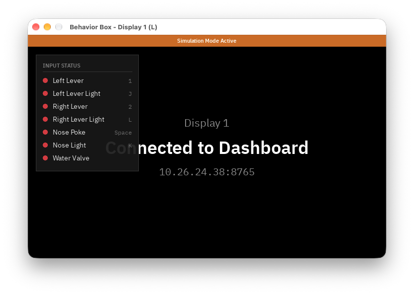

# Device

The device application runs on the behavior box. It reads the levers and nose poke, drives the lights, water valve, and stimulus displays, runs sessions sent from the dashboard, and records session data. On macOS it runs in simulation mode, with the keyboard standing in for the box's inputs.

## Requirements

- A C++17 compiler (`g++` or `clang++`)
- `make` and `pkg-config`
- SDL3 and SDL3_ttf

On macOS, install SDL with Homebrew:

```bash
brew install sdl3 sdl3_ttf pkg-config
```

On the Raspberry Pi, build SDL3 and SDL3_ttf from source. Install the build tools and display libraries first:

```bash
sudo apt install build-essential cmake git pkg-config \
  libdrm-dev libgbm-dev libegl-dev libgles-dev \
  libwayland-dev libxkbcommon-dev wayland-protocols libx11-dev libxext-dev
```

Then build and install SDL3:

```bash
git clone --depth 1 --branch release-3.2.0 https://github.com/libsdl-org/SDL.git
cmake -S SDL -B SDL/build -DCMAKE_BUILD_TYPE=Release
cmake --build SDL/build -j4
sudo cmake --install SDL/build
```

Then SDL3_ttf, which builds its own copies of FreeType and HarfBuzz:

```bash
git clone --depth 1 --branch release-3.2.2 https://github.com/libsdl-org/SDL_ttf.git
(cd SDL_ttf && ./external/download.sh)
cmake -S SDL_ttf -B SDL_ttf/build -DCMAKE_BUILD_TYPE=Release -DSDLTTF_VENDORED=ON
cmake --build SDL_ttf/build -j4
sudo cmake --install SDL_ttf/build
sudo ldconfig
```

Newer `release-3.x` tags can be used in place of the versions above. `pkg-config --modversion sdl3 sdl3-ttf` prints both versions when the installation has worked.

The WebSocket, logging, and JSON libraries (IXWebSocket, spdlog, nlohmann/json) are included in `third_party/` and are compiled with the application.

## Building

| Command | Result |
| --- | --- |
| `make mac` | Builds `dist/mac/behavior_box_device` for macOS, in simulation mode |
| `make pi` | Builds `dist/pi/behavior_box_device` for the Raspberry Pi |
| `make clean` | Deletes `dist/` |

Every `.cpp` file under `src/` is compiled automatically, so new source files do not need to be added to the makefile. Files in `assets/` are copied next to the executable.

## Running

```bash
./dist/mac/behavior_box_device [--name <name>] [port]
```

The device listens for dashboard connections on port `8765`, or on `port` if one is given. Log messages are printed to the terminal and sent to connected dashboards.

The device names itself `bbox_device_<ID>` on each start, where `<ID>` is 8 random uppercase letters and digits. Use `--name` to give it a fixed name instead. On the Raspberry Pi the name is also the Wi-Fi network's name and password (see [Wi-Fi Access Point](#wi-fi-access-point)), so it must be 8 to 32 characters of letters, digits, `_`, or `-`.

When no session is running, each display shows whether a dashboard is connected, the device's name, and its network address. Press `Esc` at any time to quit. A running session is stopped and its data saved first.

### Simulation Mode

On macOS two windows stand in for the box's displays: *Display 1 (L)* is the primary (left) display, and *Display 2 (R)* is the secondary (right) display. An orange banner marks simulation mode, and a panel on the left display shows the state of each input and output. Closing either window quits the application.



Hold a key to activate the matching input or output:

| Key | Channel |
| --- | --- |
| `1` | Left lever |
| `2` | Right lever |
| `Space` | Nose poke |
| `J` | Left lever light |
| `L` | Right lever light |
| `K` | Nose light |

The water valve has no key. It is shown in the panel when a trial or test opens it.

### Raspberry Pi

Build with `make pi` on the Pi, after installing SDL3 and SDL3_ttf as described in [Requirements](#requirements), then run `./dist/pi/behavior_box_device`.

`PiGpio` in [src/hardware/pi_gpio.h](src/hardware/pi_gpio.h) does not read the inputs or drive the pins yet. The pin assignments are defined in [src/hardware/pins.h](src/hardware/pins.h) (BCM numbering):

| Pin | Channel |
| --- | --- |
| 17 | Nose poke IR beam (input) |
| 22 | Left lever light (output) |
| 23 | Right lever (input) |
| 24 | Left lever (input) |
| 25 | Water valve (output) |
| 26 | Right lever light (output) |
| 27 | Nose light (output) |

On the Pi, each connected display gets a fullscreen window, up to two.

#### Wi-Fi Access Point

On startup the Pi switches its Wi-Fi (`wlan0`) to an access point, so the dashboard computer can join the device's own network. The network's name (SSID) and WPA2 password are both the device's name. This replaces any Wi-Fi network the Pi was connected to, and the access point is left running after the application quits. Dashboards connect to the address shown on the displays, `10.42.0.1:8765` by default.

The access point is started with NetworkManager's `nmcli`, the default on Raspberry Pi OS Bookworm and later, using a connection named `bbox-hotspot`. The user running the application needs permission to manage network connections, as the default desktop user has. If the access point cannot be started, the error is logged and the device keeps running on its existing network.

## Session Data

Session data is stored under `~/bbox_data`. A session is saved to `Subjects/<subject>/<yyyy-mm-dd>/<NNN>/`, where `<NNN>` is the next free session number for that subject and day. Characters that are not allowed in folder names are replaced with `_` in the subject name.

| File | Contents |
| --- | --- |
| `raw_task_data_00/_bbox_taskData.raw.jsonable` | One JSON object per line, one line per trial. Each includes the trial's parameters, choice, feedback, and a `behavior_data` object with `"States timestamps"`, `"Events timestamps"`, and `"Stimuli"`, in seconds from the trial start. |
| `raw_task_data_00/_bbox_taskSettings.raw.json` | Subject, date, session number, start and end times, end state (`completed` or `stopped`), protocol parameters, and session totals. |
| `raw_task_data_00/_bbox_taskProtocol.raw.json` | The protocol file exactly as the dashboard sent it. |
| `alf/_ibl_trials.table.csv` | One row per trial. The first ten columns are IBL's trials columns (`intervals_0`, `intervals_1`, `stimOn_times`, `stimOff_times`, `goCue_times`, `response_times`, `choice`, `feedback_times`, `feedbackType`, `rewardVolume`), followed by device-specific columns. Times are seconds from the session start, and `NaN` marks values that do not apply. |

Each trial is written to disk when it finishes, so a crash loses only the trial in progress. Intervals are recorded as rows like any other trial, with `NaN` for choice and stage. Intervals are not counted in the session's trial totals.

Inputs, outputs, and stimuli changed during a trial are recorded as events automatically, including changes made from the keyboard in simulation mode or by hardware tests.

## Source Layout

```text
src/
├── main.cpp                Logging setup and command-line arguments
├── application.{h,cpp}     Main loop, dashboard commands, data sync
├── version.h               Device software version
├── diagnostics/            Hardware tests requested from the dashboard
├── display/                Stimulus display windows and text rendering
├── hardware/               GPIO interface, pin numbers, simulated and Pi backends
├── network/                WebSocket server, log forwarding, device name, and Wi-Fi access point
├── session/                Protocol parsing, session running, data recording
│   └── trials/             Trial implementations
├── simulation/             Simulation banner, status panel, and key bindings
└── storage/                Data root and file listing for data sync
```

The main loop in `Application::run()` runs once per display frame. Each frame it handles window and keyboard events, handles commands received from dashboards, updates hardware tests and the active session, sends input changes to dashboards, and draws the displays.

## Extending the Device

### Trials

New training stages and trial types are added in `src/session/trials/`. See [src/session/trials/README.md](src/session/trials/README.md).

### Dashboard Commands

Commands from the dashboard are handled in `Application::handleMessage()` in [src/application.cpp](src/application.cpp). To add a command:

1. Add a branch for the command name in `handleMessage()`.
2. Add the command name to [shared/commands.json](../shared/commands.json).
3. Document the command and any reply in [shared/README.md](../shared/README.md).

Hardware tests are added in `TestRunner::start()` in [src/diagnostics/test_runner.cpp](src/diagnostics/test_runner.cpp). Output tests switch an output on for the duration sent by the dashboard. Input tests wait up to 10 seconds for an input to be triggered.

### Messages to the Dashboard

Use `server_.broadcast()` with a JSON object containing a `type` field. The dashboard ignores message types it does not know, so the dashboard must be updated to receive a new type (see [dashboard/README.md](../dashboard/README.md#adding-a-device-message)).

### Inputs and Outputs

Inputs and outputs are listed in [src/hardware/gpio.h](src/hardware/gpio.h). To add a channel:

1. Add it to the `Input` or `Output` enum, increase `kInputCount` or `kOutputCount`, and add its message name to `kInputNames` or `kOutputNames`.
2. Add a pin number to [src/hardware/pins.h](src/hardware/pins.h).
3. Add a row to `kControls` in [src/simulation/controls.h](src/simulation/controls.h) so it appears in the simulation panel, with a key if it should be controllable.
4. Add the name to `InputChannel` and `INPUT_CHANNELS` in the dashboard so it appears in *Input Status*.

### Stimuli

Trials show images by file name. Images are loaded from `assets/stimuli/` next to the executable, so place PNG or BMP files in `device/assets/stimuli/` and rebuild. Images are scaled to fit the display and centered.

### Version

Update `kDeviceVersion` in [src/version.h](src/version.h) for each release. The version is printed at startup and sent to the dashboard when it connects.
